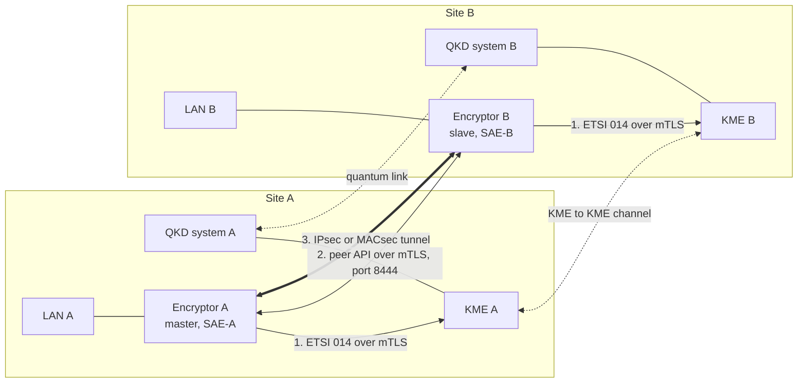
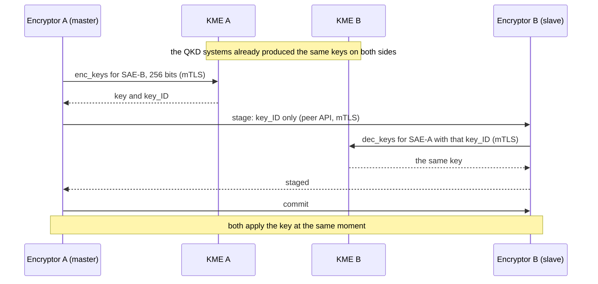
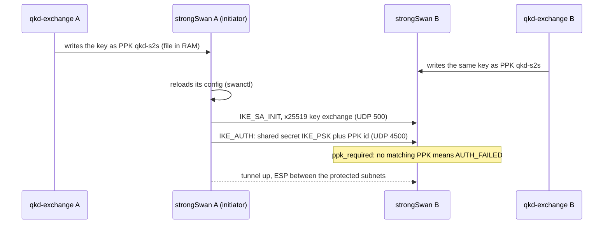
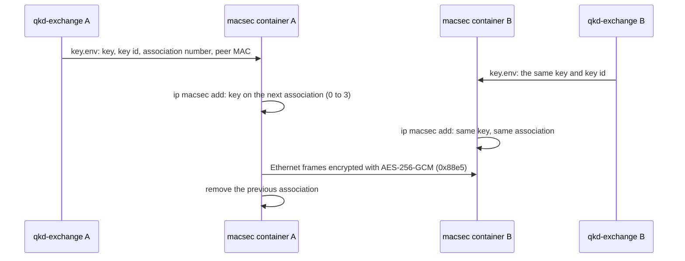
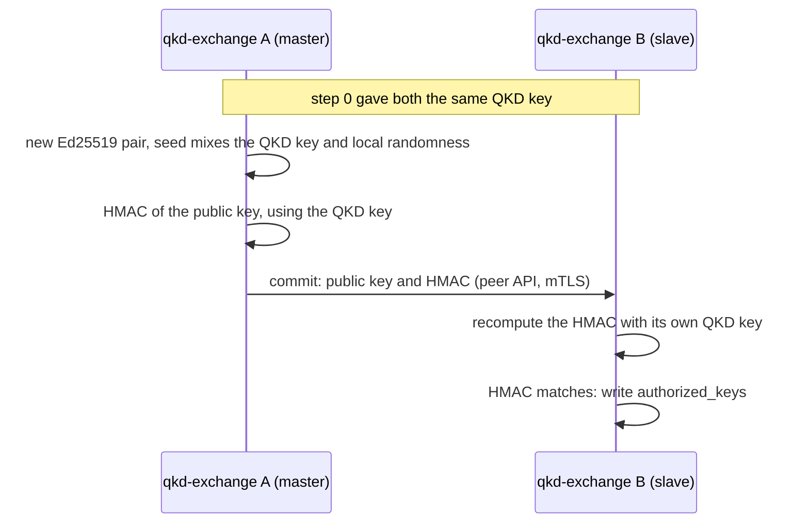
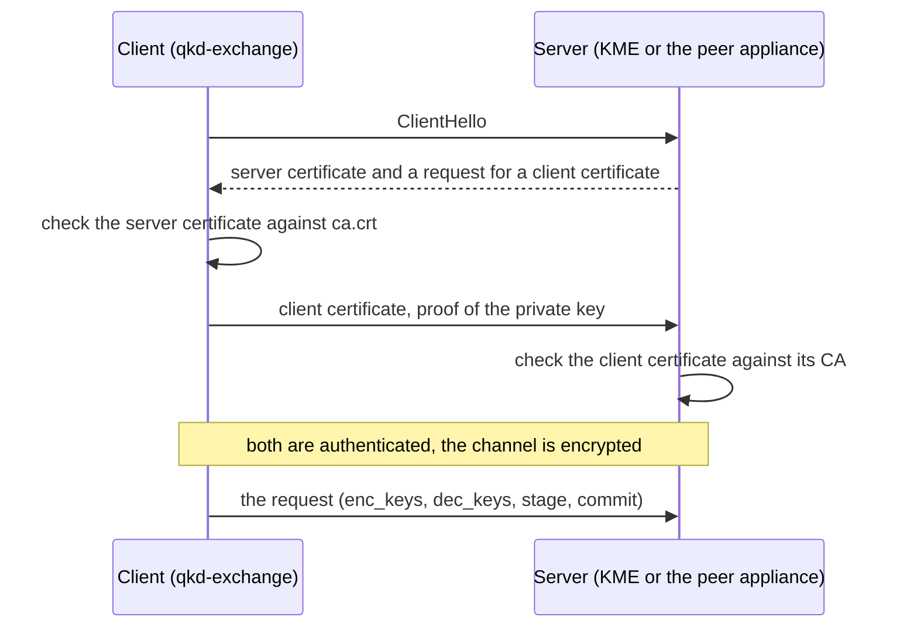

# How the encryptor works

What each box and acronym is, and who talks to whom, for the four things the appliance does: **IPsec**, **MACsec**, **SSH** keys, and **mTLS**.

## 1. The idea in one minute

- **QKD** (Quantum Key Distribution) makes the *same random key* appear at two sites, so nobody on the line could have copied it without being noticed. It produces keys. It does not encrypt anything.
- A **KME** (Key Management Entity) is the server in front of a QKD system. It stores those keys and gives them to applications through a REST API ([ETSI GS QKD 014](https://www.etsi.org/deliver/etsi_gs/QKD/001_099/014/)). There is one KME per site.
- An **SAE** (Secure Application Entity) is any application that asks a KME for keys. It has an **SAE ID** such as `SAE-A`. Each encryptor appliance is one SAE.
- The **encryptor** (this project) is a node that fetches keys from its KME and feeds them to the tools that protect traffic: strongSwan (IPsec), the Linux kernel (MACsec) and an SSH key generator.

1. Each encryptor asks **its own** KME for a key.
2. The two encryptors agree on *which* key to use by exchanging only its ID, never the key.
3. Both start using the same key in the tool that protects the traffic.

In the lab there are no QKD systems: a **KME simulator** hands out random keys and links the two sites with a simulated QKD link. The software and the diagrams are identical; only the keys are not quantum.

## 2. Components

| Component | What it does | Protocol in our case | Where it runs |
|---|---|---|---|
| QKD system | Generates identical keys at both sites | quantum link plus a classical channel, vendor specific | at the site, not in this project |
| KME | Stores QKD keys and gives them out by key ID | ETSI 014 REST over HTTPS, mTLS, port 8443 | at the site; in the lab a simulator on the appliance |
| KME to KME channel | Lets the two KMEs hold the same key | vendor specific; in the lab a simulated link on `ens6` | between the KMEs |
| `qkd-exchange` | Our KME client. Fetches keys, agrees them with the peer, hands them to the tools below, rotates them | ETSI 014 to the KME, peer API to the other appliance | container in the encryptor pod |
| Peer API | How the master tells the slave which key to use (stage, then commit) | HTTPS with mTLS, port 8444 on `ens5` | inside `qkd-exchange` |
| strongSwan | IPsec: builds the encrypted tunnel | IKEv2, ESP, UDP 500 and 4500 | container `strongswan` |
| `ip macsec` | MACsec: encrypts Ethernet frames on a NIC (kernel feature) | IEEE 802.1AE, EtherType `0x88e5` | container `macsec`, kernel module on the host |
| SSH key rotation | Creates a new Ed25519 key pair and sends the public key to the peer | files plus the peer API | inside `qkd-exchange` |
| CA and certificates | Prove who is who for every mTLS connection | X.509 | Secret `kme-tls`: `ca.crt`, `tls.crt`, `tls.key` |
| Console | Web page showing the pair, the tunnels and key rotation | HTTPS, Let's Encrypt | master only, `https://<FQDN>` |

**Master and slave** only decide who asks first. The master calls `enc_keys` and starts IPsec; the slave calls `dec_keys`. Neither is more trusted.

### The network cards

| Card | Portal interface | Use |
|---|---|---|
| `ens3` | interface1 | management: SSH and the public console |
| `ens4` | interface2 | k3s cluster traffic |
| `ens5` | interface3 | encryptor to encryptor: peer API and IKE |
| `ens6` | interface4 | KME to KME channel |
| `ens7` | interface5 | MACsec |

## 3. Step 0, for every use case: both sides get the same key

This is what `qkd-exchange` does before any tunnel is touched.

- The **key never travels between the appliances**. Only the **key_ID**, a UUID, does. Each side gets the key from its own KME.
- **Stage then commit** makes both ends switch together, so the tunnel never sees a key only one side has.
- The QKD keys for IPsec and MACsec are held in RAM only. The SSH key pair is written to disk. No key is ever logged.

## 4. Use case 1: IPsec

IPsec encrypts IP traffic between two subnets. The QKD key is added as a **PPK** (Post-quantum Preshared Key, RFC 8784) to the IKEv2 key exchange, so the tunnel stays safe even against a future quantum computer.

| Item | Value |
|---|---|
| Tool | strongSwan 5.9 (`charon`, `swanctl`) |
| Authentication | `IKE_PSK`, the same shared secret on both ends, plus the PPK |
| Algorithms | IKE `aes256gcm16-prfsha384-x25519`, ESP `aes256gcm16-x25519` |
| Protected traffic | `LOCAL_TS` to `REMOTE_TS` (two subnets behind the appliances) |
| Ports | UDP 500, UDP 4500, ESP (protocol 50), on `ens5` |
| New key | every hour; used at the next IKE re-authentication, also every hour |
| Pinging the peer address | proves the link, **not** the encryption: only the protected subnets go through the tunnel |

## 5. Use case 2: MACsec

MACsec encrypts **Ethernet frames** on one link (layer 2), below IP. Two NICs facing each other, here `ens7`, talk through a `macsec0` interface.

| Item | Value |
|---|---|
| Tool | `ip macsec` (iproute2) and the Linux `macsec` kernel module |
| Key | the QKD key **is** the SAK, 256 bits, GCM-AES-256 |
| Key agreement | none: no MKA, so no CAK or CKN (see the glossary) |
| Rotation | every 24 hours; the new key goes on the next of four associations, then the old one is removed, so no traffic is lost |
| Needs | the virtual switch must pass EtherType `0x88e5` between the two NICs (not yet verified on Equinix) |

## 6. Use case 3: SSH

SSH is the odd one: it is **not a tunnel**. The appliance rotates an **SSH key pair** and uses the QKD key to prove the public key is genuine.

| Item | Value |
|---|---|
| Key type | Ed25519 |
| What QKD adds | someone sitting on the peer API cannot swap in their own public key: it would fail the HMAC |
| Result | files under `/var/lib/encryptor/ssh/ssh` on the node: private key on A, `authorized_keys` on B |
| Rotation | every 24 hours |
| Limit | nothing wires these keys into `sshd` or an SSH client automatically. QKD does not protect the SSH session itself, only the key pair |

## 7. Use case 4: mTLS

**TLS** protects a connection and proves the **server** is who it claims. **mTLS** (mutual TLS) also makes the **client** prove who it is, with its own certificate. Both certificates are checked against the same **CA**.

mTLS is used in **two places**:

| Connection | Server | Client | Why mTLS |
|---|---|---|---|
| Encryptor to KME, port 8443 | KME | `qkd-exchange` | the KME maps the client certificate to an SAE ID and decides which keys it may get |
| Encryptor to encryptor, port 8444 | peer API | the other `qkd-exchange` | only the peer may stage and commit keys |

This is ordinary certificate security (PKI), **not** QKD. The three files `ca.crt`, `tls.crt` and `tls.key` are loaded into Secret `kme-tls` after boot, never through Day 0.

## 8. Who uses what

| Use case | Key comes from | Fetched and agreed by | Used by | Protocol | Card | New key |
|---|---|---|---|---|---|---|
| IPsec | KME, QKD key as PPK | `qkd-exchange` | strongSwan | IKEv2, ESP | `ens5` | 1 hour |
| MACsec | KME, QKD key as SAK | `qkd-exchange` | `ip macsec`, kernel | 802.1AE | `ens7` | 24 hours |
| SSH | KME, QKD key mixed into the seed and the HMAC | `qkd-exchange` | key files for `sshd` or a client | Ed25519, HMAC | files | 24 hours |
| mTLS | a CA, not QKD | you load the certificates | `qkd-exchange` and the KME | TLS 1.2 or later | `ens5` and the KME network | when you rotate the certificates |

## 9. Glossary

| Term | Meaning |
|---|---|
| **QKD** | Quantum Key Distribution: produces identical random keys at two places |
| **KME** | Key Management Entity: the key server of a QKD system |
| **SAE**, **SAE ID** | Secure Application Entity and its name, an application that uses keys. Do not confuse with SA |
| **ETSI GS QKD 014** | the REST API an SAE uses to get keys: `status`, `enc_keys`, `dec_keys` |
| **key_ID** | a UUID naming one key. The only thing sent between the appliances |
| **TLS**, **mTLS** | encrypted connection, with the server only or with both sides authenticated by certificates |
| **CA** | Certificate Authority: signs the certificates everyone trusts |
| **IPsec**, **IKEv2**, **ESP** | tunnel protocol, its key exchange, and the part that carries encrypted packets |
| **SA** | **Security Association**: one set of keys and parameters for one direction of a tunnel (IPsec SA, MACsec SA). Not the same as SAE |
| **PSK**, **IKE_PSK** | pre-shared key: a secret both ends already have, used here to authenticate IKE |
| **PPK** | Post-quantum Preshared Key (RFC 8784): an extra secret mixed into IKEv2, here the QKD key |
| **MACsec**, **802.1AE** | encryption of Ethernet frames on one link |
| **SAK** | Secure Association Key: the key that encrypts the frames. Here the QKD key |
| **MKA**, **CAK**, **CKN** | the standard way to get a SAK: MKA is the protocol, **CAK** the long-term pre-shared key (you may also see it written CKK), **CKN** its name. Not used here, because the QKD key is the SAK directly |
| **AN** | association number, 0 to 3: which of the four MACsec keys is in use |
| **SSH**, **Ed25519** | secure shell, and a modern elliptic-curve key type |
| **HMAC** | a checksum computed with a secret key. Proves the public key came from someone holding the QKD key |
| **master**, **slave** | which appliance asks the KME first: `enc_keys` (master) or `dec_keys` (slave) |
